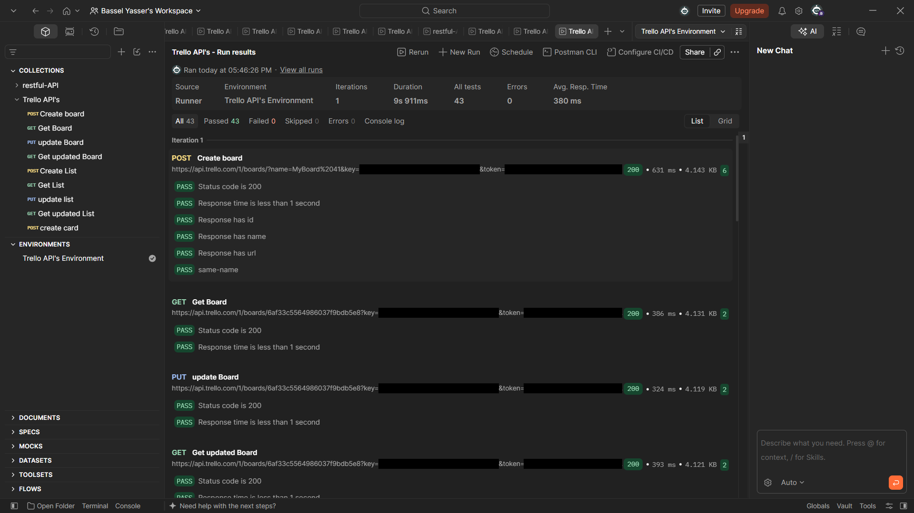
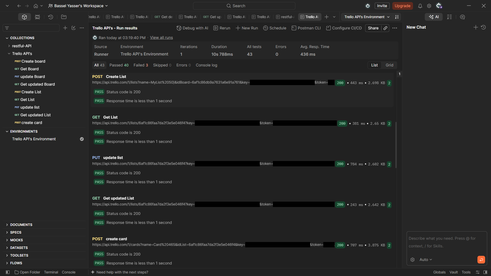
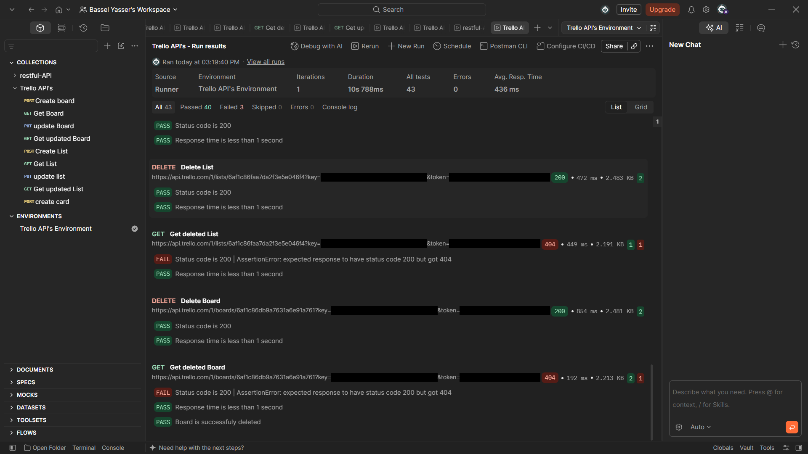
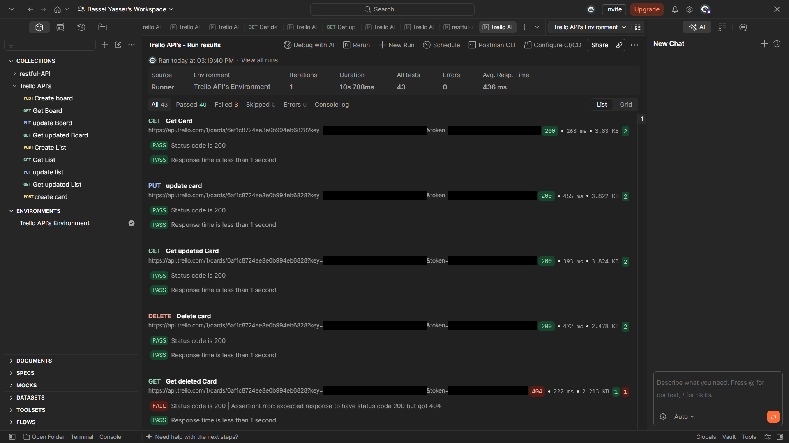
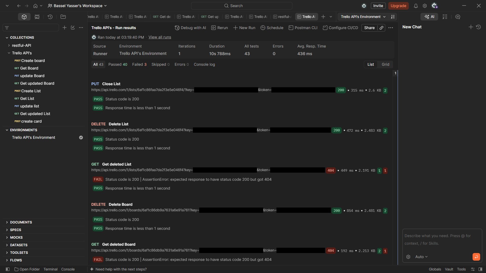

# API Testing with Postman

API test collections for two public REST APIs, built in Postman as the final projects of the Udemy course
**The Complete 2026 Software Testing Bootcamp** (Tarek Roshdy, Nezam Academy).

| Collection | API | Requests | Tests | Result |
|---|---|---|---|---|
| RESTful API | [api.restful-api.dev](https://restful-api.dev) | 7 | 14 | 14 passed |
| Trello API | [api.trello.com](https://developer.atlassian.com/cloud/trello/rest/) | 19 | 43 | 43 passed |

## What is tested

### RESTful API (`restful-api.postman_collection.json`)
Full CRUD on an object in a collection:

1. `GET` all collections
2. `GET` objects
3. `POST` create a new object
4. `PUT` update the object
5. `PATCH` partially update the object
6. `GET` the single object
7. `DELETE` the object

### Trello API (`trello-api.postman_collection.json`)
The full life of a board, a list and a card:

| Board | List | Card |
|---|---|---|
| Create board | Create list | Create card |
| Get board | Get list | Get card |
| Update board | Update list | Update card |
| Get updated board | Get updated list | Get updated card |
| Delete board | Close (archive) list | Delete card |
| Get deleted board | Delete list | Get deleted card |
| | Get deleted list | |

## Techniques used

- **Request chaining:** the `POST` requests save the new item's `id` into a variable (`BoardId`, `ListId`, `CardId`, `object id`), and the requests after them use it.
- **Dynamic test data:** pre-request scripts give each board, list and card a random name (for example `MyBoard 167`), so every run creates fresh data.
- **Assertions on every request:** a collection-level script checks the status code (200, or 404 for deleted items) and that the response arrives in under 1 second.
- **Response-body checks:** *Create board* checks that the response has an `id`, `name` and `url`, and that the returned name matches the name sent.
- **Negative checks:** after each delete, the *Get deleted* requests check that the board, list and card now return **404 Not Found**.
- **Environment variables:** the base URL, key and token are stored in an environment, not typed into the requests.
- **Pre-request API call:** *Delete list* closes the list first with `pm.sendRequest`, because Trello requires a list to be archived before it is deleted.

## Test results

### RESTful API: 14 of 14 passed
Average response time 365 ms.


### Trello API: 43 of 43 passed
Average response time 380 ms. Key and token are hidden in the screenshots.







### Fixed: 3 failures in the first run
The first run passed 40 of 43 tests. The 3 failures were in **Get deleted card**, **Get deleted list** and
**Get deleted board**. Each runs after the item is deleted, and Trello correctly answered **404 Not Found**,
but the collection-level test expected 200 on every request.

So the API was right and the test was wrong. The collection-level script now expects 404 for the
"Get deleted" requests and 200 for all others. The re-run passed all 43 tests.

The same review also found a typo in the test data: the list name was sent as `{{MyList}}}`, with one
extra bracket, so Trello saved names like `MyList 50}`. It is now `{{MyList}}`.

## How to run

1. Import the two collections and `trello-api.postman_environment.json` into Postman.
2. **Trello:** get an API key and token from the [Trello developer page](https://trello.com/power-ups/admin), then
   replace `YOUR_TRELLO_KEY` and `YOUR_TRELLO_TOKEN` in the environment. Select the environment.
3. **RESTful API:** create a free API key on [restful-api.dev](https://restful-api.dev) and replace
   `YOUR_RESTFUL_API_KEY` in the collection's **Authorization** tab.
4. Run each collection with the **Collection Runner**, or from the command line with Newman:
   ```
   newman run trello-api.postman_collection.json -e trello-api.postman_environment.json
   ```

No real keys or tokens are stored in this repository.

## Files

| File | What it is |
|---|---|
| `restful-api.postman_collection.json` | RESTful API collection |
| `trello-api.postman_collection.json` | Trello API collection |
| `trello-api.postman_environment.json` | Trello environment (placeholders only) |
| `*.png` | Collection Runner results |
